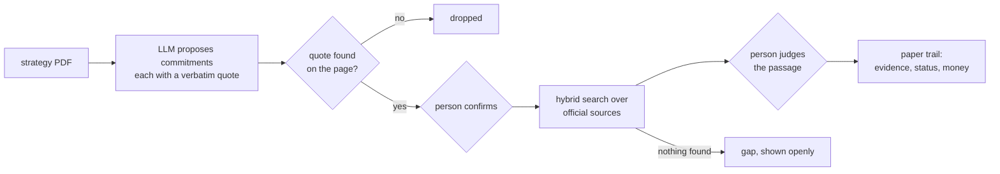

# Paper Trail

[](https://github.com/unnobatroo/paper-trail/actions/workflows/ci.yml)
[](LICENSE)
[](https://huggingface.co/unnobatroo/paper-trail-qwen3-4b-instruct-hu-awq)

**Did a city actually do what its climate strategy promised?**

Paper Trail reads the strategy, pulls out every commitment with a verbatim quote as proof,
searches the official sources for evidence, and hands everything to a person to confirm.
Nothing reaches the public record without a human click.




## Numbers

- **Extraction**: recall 0.87, precision 0.93, F1 0.90, macro over 6 holdout strategies the
  model was never tuned on (834-row gold set, 9 strategies, Hungarian and English).
  Error analysis took holdout recall from 0.66 to 0.86 on the same weights
  ([#24](https://github.com/unnobatroo/paper-trail/pull/24))
- **Retrieval**: dense vs hybrid vs reranked, benchmarked on 679 blind graded labels
  ([#35](https://github.com/unnobatroo/paper-trail/pull/35)). It turned out reviewer
  accepts agreed with blind grading only 58% of the time, so they're no longer used as labels
- **Runs on one 8 GB GPU**: a 4-bit AWQ Qwen3-4B
  ([on Hugging Face](https://huggingface.co/unnobatroo/paper-trail-qwen3-4b-instruct-hu-awq)),
  an embedder and a reranker, all self-hosted, no paid AI APIs. Search also runs CPU-only
  (model2vec), extraction needs an OpenAI-compatible LLM server

Caveats (pooled gold, small test set) are on the [Models](https://github.com/unnobatroo/paper-trail/wiki/Models) page.

## How it stays honest

- **Receipts or nothing**: every commitment points to a page and an exact quote, and
  every piece of evidence to a URL and a passage
- **Humans decide, and the database backs it up**: the worker's Postgres role can't confirm a
  candidate or accept a link, triggers stop it rewriting links and evidence a reviewer already
  decided on (reviewers can still change their minds), and it won't start with a stronger login
- **Audit rules** catch cancelled contracts, money that was budgeted but never spent, and
  work owned by a different public body ([Accountability Rules](https://github.com/unnobatroo/paper-trail/wiki/Accountability-Rules))

Stack: Python, FastAPI + NiceGUI, PostgreSQL + pgvector (also the job queue), Qwen3 behind
an OpenAI-compatible SGLang gateway, Docker Compose + Caddy.

## Run it

```sh
make setup && make dev     # api + review ui on :8000, fully offline by default
```

Live instance (Józsefváros, Budapest District VIII): https://paper-trail.jismailov.com

All documentation lives in the **[wiki](https://github.com/unnobatroo/paper-trail/wiki)**:
start with [Home](https://github.com/unnobatroo/paper-trail/wiki), then
[Getting Started](https://github.com/unnobatroo/paper-trail/wiki/Getting-Started).
